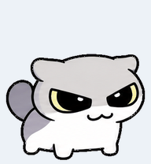

# 呆毛八条 · Windows 桌面宠物

灰白小猫，黄边斜眼、粗卷尾。把原先应用内的宠物动画带到 Windows 桌面。



这是独立的 C# 桌面程序：无需登录、无需 Python，不连接 GPT 或任何网络服务，也不会修改原应用的宠物设置。

## 下载运行

从 [Releases](https://github.com/Lixuu2001/daimao-batiao-pet/releases/latest) 下载 `DaimaoBatiao-windows.zip`，解压后双击 `DaimaoBatiao.exe`。

面向 Windows 10 / 11，需要 .NET Framework 4.8。源码构建和运行已在维护者的 Windows 环境验证，其他系统版本未逐一测试。程序未做代码签名。

## 操作

| 操作 | 效果 |
| --- | --- |
| 左键单击猫咪 | 跳跃一次后回到待机 |
| 按住左键拖动 | 移动宠物，松手后回到待机 |
| 右键猫咪 | 动作、朝向、大小、暂停、回到主屏幕、退出 |
| 右键系统托盘图标 | 同样的控制菜单 |
| 窗口获得焦点时按 Esc | 退出 |

提供 9 种动作、16 个朝向和 75%–200% 五档大小。默认 125%，透明背景、始终置顶；拖出工作区后会在松手时收回边界。暂停只停止自动逐帧播放，仍可拖动、选择动作首帧或朝向。朝向为静态姿势，选择动作或单击即可返回动画。

设置仅在本次运行有效，不写注册表、不自动启动、不采集用户数据。托盘图标可能位于 Windows 的隐藏图标区域。

## 从源码构建

在 Windows PowerShell 中进入项目目录运行：

```powershell
powershell -NoProfile -ExecutionPolicy Bypass -File .\build.ps1
.\dist\DaimaoBatiao.exe
```

脚本使用 Windows .NET Framework 自带的 C# 编译器，先运行行为测试，再构建程序；不下载依赖。PNG 作为资源嵌入 exe，因此分发时不需要另带图片。

在有交互式桌面的 Windows 会话中运行 `powershell -NoProfile -ExecutionPolicy Bypass -File .\test.ps1`，还会检查真实窗口的点击、拖动、菜单与全部帧渲染。

```powershell
# 真实窗口冒烟测试：约两秒后自动退出
Start-Process .\dist\DaimaoBatiao.exe -ArgumentList '--smoke-test' -Wait
```

## 代码结构

- `src/Animation.cs`：动画状态、点击与拖动阈值、屏幕边界计算。
- `src/Program.cs`：鼠标交互、动作菜单、托盘和窗口生命周期。
- `src/LayeredWindow.cs`：通过 Windows `UpdateLayeredWindow` 显示逐像素透明图像。
- `tests/`：动画行为与真实窗口渲染检查。
- `assets/`：原始图集与演示动画。

透明窗口实现参考 [Microsoft UpdateLayeredWindow 文档](https://learn.microsoft.com/en-us/windows/win32/api/winuser/nf-winuser-updatelayeredwindow)。

## 许可与来源

程序源码和文档采用 [MIT](LICENSE)。角色图片单独适用 [素材说明](ASSETS.md)，不包含在代码的 MIT 授权中。本项目不是 Oops Dot 或 OpenAI 官方项目。
